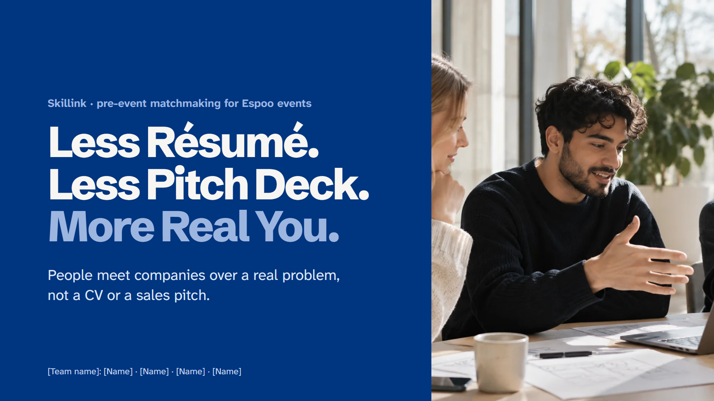
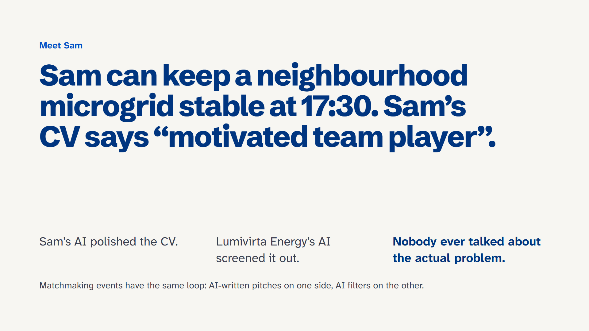
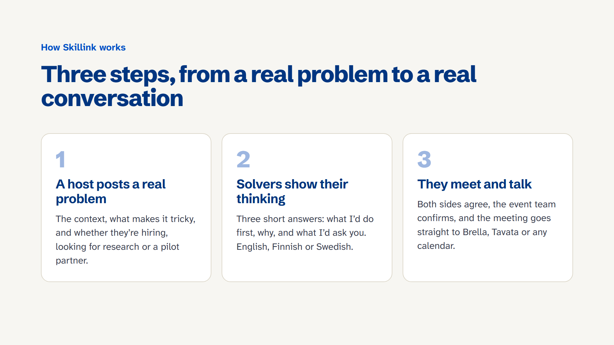
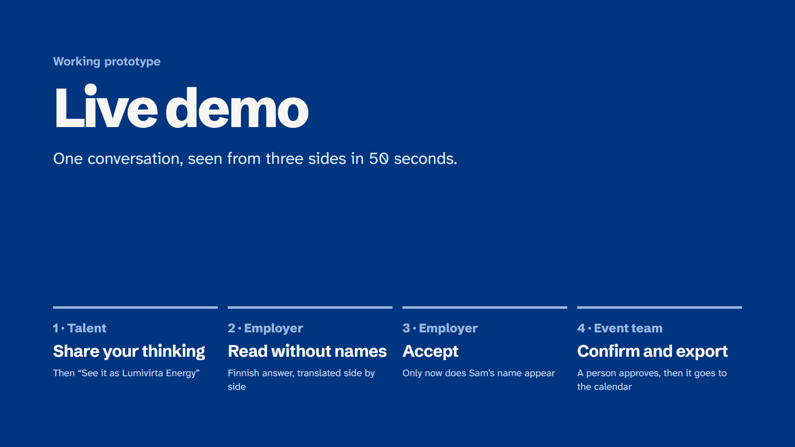
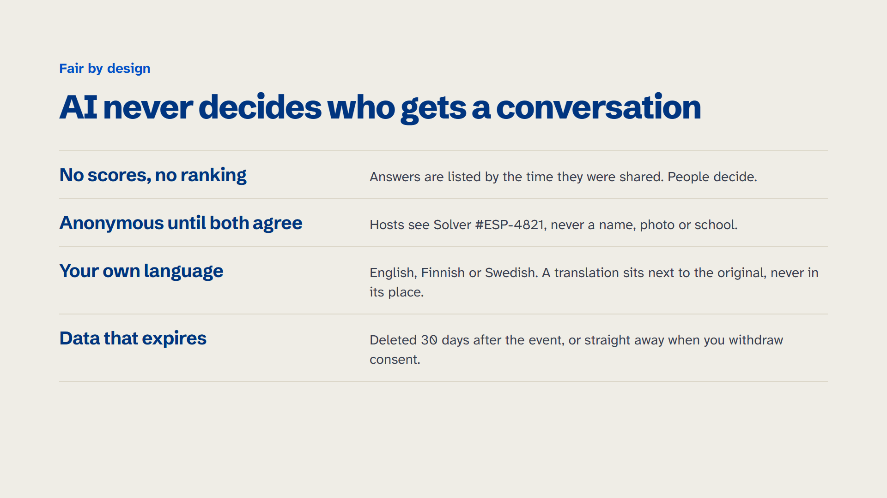
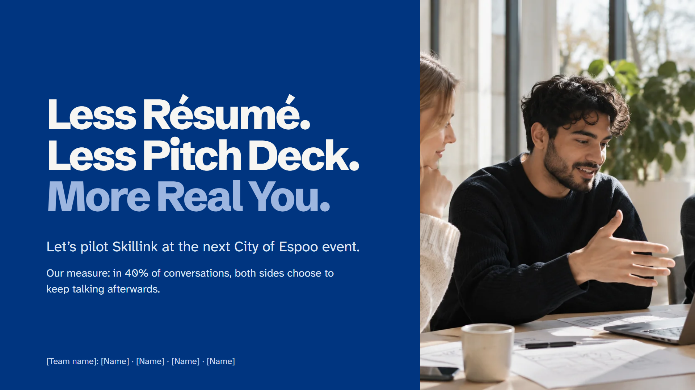
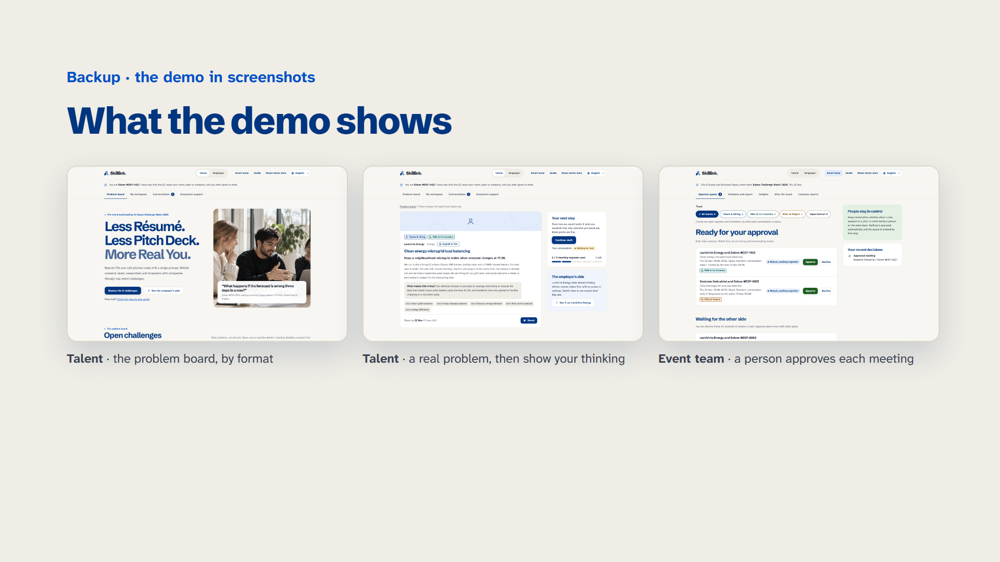
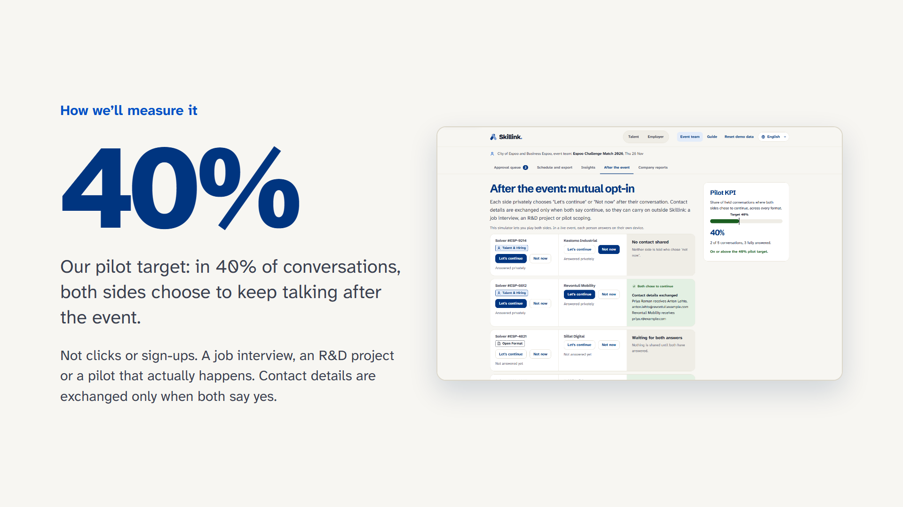
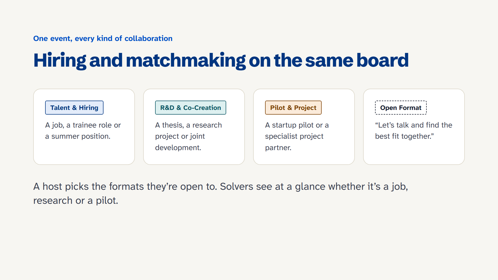
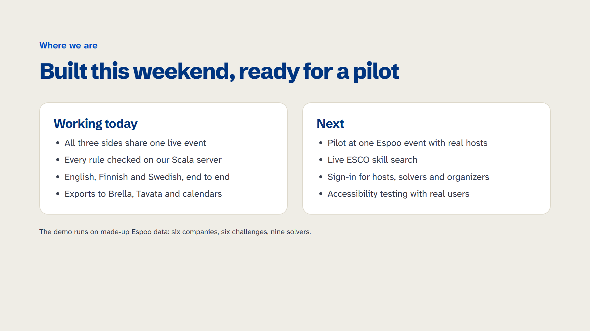

# Skillink pitch (2 minutes)

A two-minute pitch with a 50-second live demo of this app, built on Junction's pitching advice.

- `slides/`: the deck as 1920×1080 images, in order. Slides 1–6 are the pitch; 7–10 are backups for questions.
- `pitch-playbook.html`: open it in a browser. It has the rehearsal timer, the run of show, the exact demo clicks, the fallback plan and Q&A answers.

Before the demo: start the server (`sbt run` or the IntelliJ run configuration), open http://localhost:8081, click **Reset demo data**, then open My workspace → Continue draft on the Lumivirta Energy challenge and type one line under question 2.

## Slides and speaker notes

### 1. Cover

0:00–0:05. One line only: "We're [team name]: [names]. We built Skillink." Then click straight to Sam.

### 2. Meet Sam

0:05–0:25 (20 seconds). "Sam can keep a microgrid stable when every electric car plugs in at 17:30. Sam's CV says 'motivated team player'. Sam's AI polished it, Lumivirta's AI screened it out. Nobody ever talked about the actual problem. Startups pitching to corporates get exactly the same thing."

### 3. How it works

0:25–0:40 (15 seconds). "A company posts a real problem. People answer three questions, and the third is: what would you ask us? When both want to meet, the event team confirms it. Let me show you." Switch to the browser on "show you".

### 4. Live demo

0:40–1:30 (50 seconds). Don't stop on this slide: switch to the browser at once. Before going on stage: Reset demo data, open My workspace, Continue draft on the Lumivirta challenge, type one line under question 2, and leave the editor open.

1 Talent (10 s): tick consent, Share with Lumivirta Energy, click "See it as Lumivirta Energy" in the message. "No CV, no photo. Three short answers."

2 Employer (15 s): click "EU-Hosted Machine Translation (Simulated)" under the Finnish answer from #ESP-2093. "No names, no scores, oldest first. The translation sits next to the original."

3 Employer (10 s): Conversations, Accept. "Only now does Sam's name appear."

4 Event team (15 s): Event team, Approve on the THIRD card (Lumivirta and #ESP-4821), Schedule and export, point at the three download buttons. "A person confirms every meeting, and it goes to Brella, Tavata or your calendar."

If anything breaks: jump to the backup slide right after the closing slide.

### 5. Fair by design

1:30–1:45 (15 seconds). Don't read the rows. One sentence: "Hiring with AI is high-risk under the EU AI Act, so in Skillink AI never scores, ranks or filters people. It only translates, and the original stays visible." Say "designed with the EU AI Act in mind", not "compliant".

### 6. Close

1:45–2:00 (15 seconds). "Sam doesn't need a better CV. Sam needs one real conversation. Let's pilot Skillink at the next Espoo event, and measure it by one number: how many conversations continue after the event. Our target is 40%. Thank you." Then stop. Leave this slide up during Q&A; the slides after it are backups for questions.

### 7. Backup: demo screenshots

Only if the live demo fails. Walk through the three screenshots in 20 seconds with the same lines as the demo, then jump back to the "Fair by design" slide (slide 5).

### 8. Backup: 40% pilot target

Q&A backup, for "How would you know it works?". Be honest: 40% is the target we would track in a pilot, not a result. "After the event, each side privately says 'Let's continue' or 'Not now'. Only a mutual yes shares contact details. That's the number we'd show the City of Espoo."

### 9. Backup: collaboration formats

Q&A backup, for "Is this only for hiring?". "One host can be hiring and open to a thesis at the same time, so Skillink works for a career fair and a startup–corporate matchmaking day alike." This is the slide that shows it works for both Espoo event types.

### 10. Backup: where we are

Q&A backup, for "What did you actually build?" and "What's next?". Honest and concrete. "What you saw is working code, not a mockup: a Scala server holds every rule, like the five-request limit and the identity reveal. It runs on made-up data. Next, we want to run it at one real Espoo event." Don't oversell.
